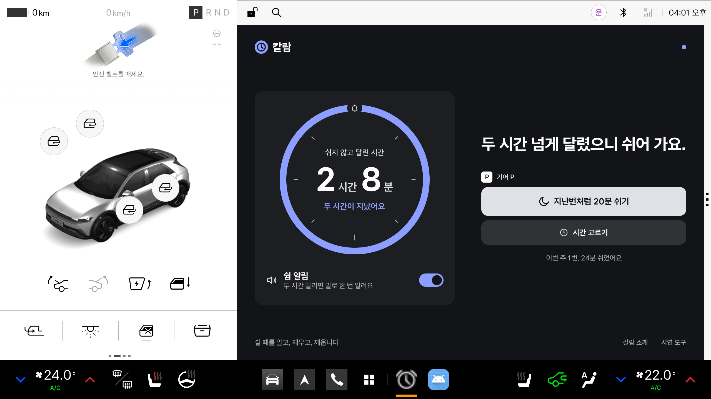
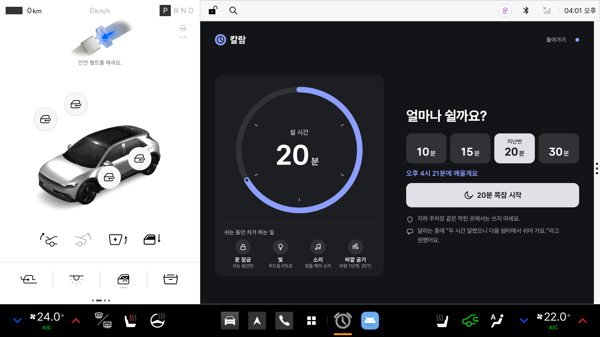
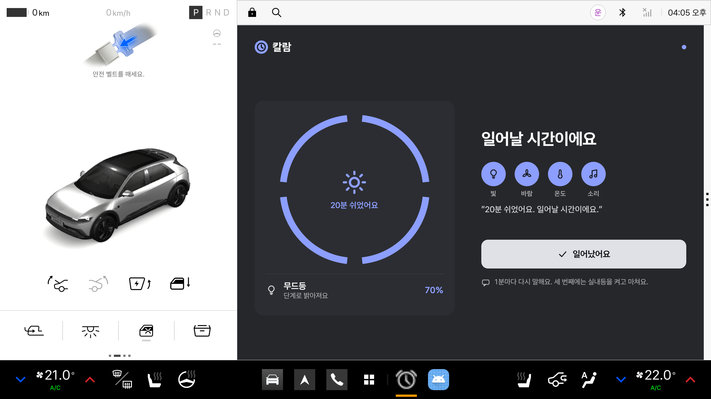
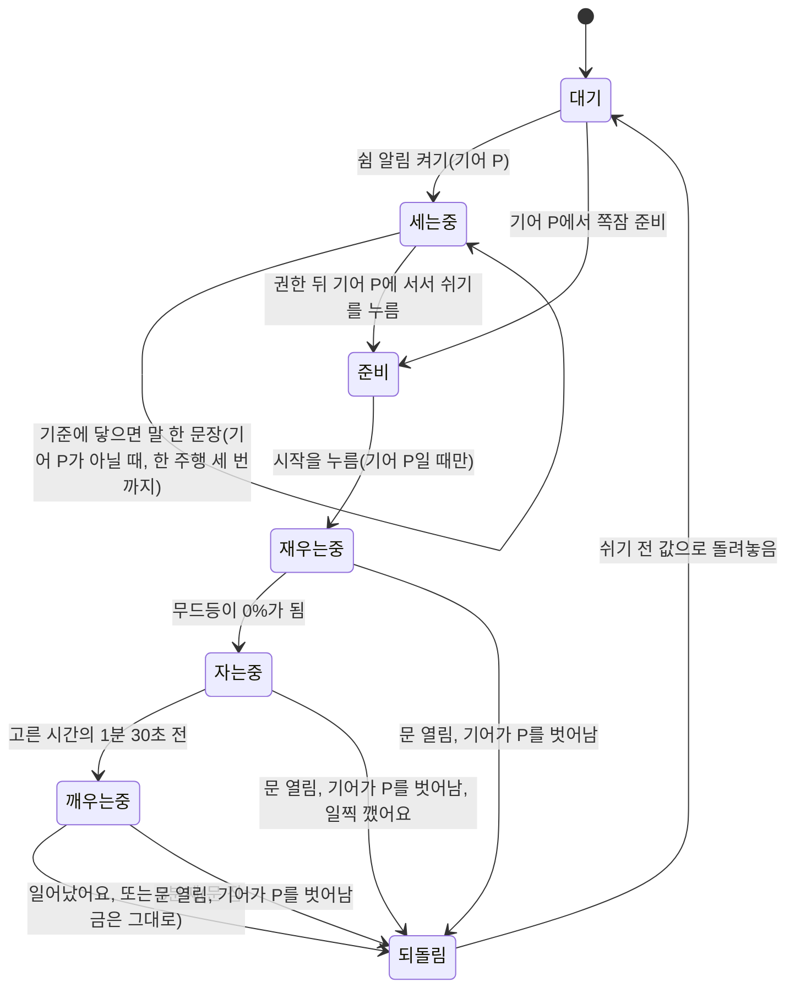

# 칼람(Carlarm) 0.3.1

## 1. 앱 이름과 한 줄 소개

**차가 울리는 알람, 칼람. 쉴 때를 알고, 재우고, 깨웁니다.**

차량 데이터로 쉴 때를 알아 차가 먼저 쉬자고 말하고, 쉬는 동안은 차가 알람시계가 되어 주는 장거리 운전자의 앱입니다. Pleos Connect(Android Automotive OS)용으로 만들었습니다.

0.2에는 두 부분이 있습니다. 하나는 "쉼 알림"입니다. 기어 신호로 쉼 없이 달린 시간과 내기 순환으로 달린 시간을 세다가 기준에 닿으면 화면 없이 차의 말 한 문장으로 쉬자고 권하고, 쉼터에 서면(기어 P) 쪽잠 준비를 엽니다. 차가 판단한 운전자 졸음 값은 일반 앱이 읽을 수 없어(권한), 졸음이 오기 쉬운 때를 차의 신호로 셉니다. 다른 하나는 "쉼터에 서서 쪽잠 한 바퀴"를 차의 장치로 돌리는 부분입니다. 쉬기 전 차 안의 값을 적어 두고, 빛과 공기와 소리로 재우고, 정한 시간에 빛과 바람과 소리와 말로 깨운 뒤, 쉬기 전 값으로 되돌립니다.

0.3은 0.2의 기능에 새 화면을 얹은 판입니다. 어두운 판 위에 큰 고리 하나와 남빛 하나를 쓰고, 한 화면은 지금 상태에서 할 일 하나를 묻습니다(큰 문장 하나, 주 버튼 하나). 시험할 때 쓰는 조작(빠르게 보기, 권하는 말 들어 보기, 쉰 기록 지우기, 물음 다시 답하기, 달린 시간과 기준 숫자)은 시작 화면 오른쪽 아래의 "시연 도구" 판에만 둡니다. 차가 쉬자고 권한 뒤 P에 서면, 0.2처럼 쪽잠 준비를 바로 여는 대신 시작 화면이 쉬자는 말과 "지난번처럼 N분 쉬기"를 먼저 보입니다.

0.3.1은 0.3에 한 가지를 더한 판입니다. 쪽잠을 시작할 때 깨울 때를 시스템 알람(`AlarmManager.setAlarmClock`)에도 걸어 두어, 그 사이 앱이 죽어 있어도 시스템이 서비스를 깨워 남은 차례를 잇습니다. 알람은 사용자가 시작한 쪽잠에만 걸고 쪽잠이 끝나면 지웁니다. 화면은 0.3과 같습니다.

0.3이 에뮬레이터에서 도는 모습은 [docs/demo_0.3_emulator.mp4](docs/demo_0.3_emulator.mp4)에 있습니다(119초, 소리 없음). 공식 가상 콘솔(일인칭 주행 화면과 차 상태 카드)과 에뮬레이터의 실제 앱 화면을 나란히 담았습니다. 쉼 알림 켜기, 달림, 차의 말, 서서 P, 쪽잠, 깨우기, 되돌림, 다시 출발의 차례이고, 1분을 2초로 돌리고 긴 구간은 빠르게 감았습니다.

| 시작(두 시간 넘게 달린 뒤 P) | 쪽잠 준비 | 깨우는 중 |
|---|---|---|
|  |  |  |

에뮬레이터에서 찍은 2560×1440 그림입니다. 오른쪽 어두운 부분이 칼람의 창입니다. 나머지 그림은 [docs/screens2](docs/screens2)에 있습니다.

## 2. 실행 방법

### 설치와 켜기

```
adb install -r apk/개인_칼람_release.apk
adb shell am start -n kr.carlarm.app/.MainActivity
```

Pleos의 차량 권한은 설치할 때 허용되었습니다(아래 테스트 환경 기준). 앱 등록 키는 필요하지 않습니다.

### 가상 콘솔을 켜 두어야 합니다

에뮬레이터에서 차 값을 바꾸는 요청은 **가상 콘솔(Virtual Console)이 켜져 있을 때만** 실제 값에 반영되었습니다. 콘솔이 꺼져 있으면 SDK가 성공이라고 답해도 값이 그대로인 경우를 보았습니다. 시험하는 동안 콘솔 화면을 브라우저에 열어 두세요.

```
adb forward tcp:8088 tcp:8088
# 브라우저로 http://127.0.0.1:8088/ 을 열어 둡니다
```

그래서 칼람은 SDK의 성공 답만 믿지 않고, 값을 보낸 뒤 다시 읽어 실제로 바뀌었는지 확인합니다. 돌려놓지 못한 장치는 되돌린 화면에 이름을 적습니다.

### 한 바퀴 돌리는 차례

쉼 알림(먼저 해 볼 때): 시작 화면에서 "쉼 알림 켜기"를 누르고 콘솔에서 기어를 D로 둡니다. 빠르게 보기를 켜 두면 1분이 2초입니다. 콘솔의 공조 순환이 켜져 있으면 40분(약 80초)에 "내기 순환으로 40분 달렸으니 바깥 공기로 바꾸거나 쉬어 가요.", 그 뒤 30분(약 60초)을 더 달리면 처음 물음 둘째 답에 따라 "바깥 공기로 바꿔 보세요." 또는 "글레오에게 음악을 틀어 달라고 해 보세요.", 달린 시간이 기준(첫째 답 60, 90, 120분. 밤 10시~새벽 5시와 낮 1시~3시에는 90분 이하)에 닿으면 "두 시간 달렸으니 다음 쉼터에서 쉬어 가요."라고 말합니다. 말은 앱 화면이 가려진 채로 하고, 한 주행에 세 번까지입니다. 콘솔에서 기어를 P로 돌리면 시작 화면이 "두 시간 넘게 달렸으니 쉬어 가요."(기준이 120분일 때)로 바뀌고 "지난번처럼 N분 쉬기"(쉰 기록이 없으면 "쪽잠 준비")를 보입니다. P에 15분 넘게 서 있으면 처음부터 다시 셉니다.

쪽잠:

1. 기어를 P에 둡니다(쪽잠은 P에서만 시작합니다).
2. 처음 켜면 소개 한 장("시작하기")과 물음 셋이 나옵니다. 답하거나 건너뜁니다. 소개는 시작 화면 오른쪽 아래 "칼람 소개"로 다시 볼 수 있습니다.
3. 시작 화면 오른쪽 아래 "시연 도구"에서 '빠르게 보기'(1분을 2초로)를 켜면 20분 쪽잠이 약 40초에 끝납니다. 켜 두면 머리줄 오른쪽 끝에 남빛 점이 보입니다.
4. "쪽잠 준비" → 10, 15, 20, 30분 가운데 고르고 "20분 쪽잠 시작". 쉰 기록이 있으면 시작 화면에 "지난번처럼 N분"이 생겨, 그 분이 골라진 채 쪽잠 준비를 엽니다.
5. 재우는 중(지금 하는 일 한 문장과 차례 점) → 자는 중(검은 화면, 누르면 남은 시간과 "일찍 깼어요") → 깨우는 중("일어날 시간이에요") → "일어났어요" → 되돌린 화면
6. 안전 장면: 자는 중에 콘솔에서 문을 열거나 기어를 D로 바꾸면 바로 쉬기 전 값으로 되돌립니다.
7. 깨운 뒤 3분 동안 답이 없으면 실내등을 켜고 쉬기 전 값으로 되돌리되, 문 잠금은 잠근 채로 둡니다. 되돌린 화면의 "문 잠금 풀기"로 풉니다.
8. 쪽잠과 쉼 알림이 도는 동안에는 앞에서 도는 서비스가 앱을 지킵니다. 다른 앱(내비)을 앞에 띄워도 차례가 이어지고, 그때 깨울 시간이 되면 "일어났어요" 버튼이 달린 알림을 띄웁니다(0.2에서 확인. 이 에뮬레이터에서는 알림판에 보임). 앱이 죽으면 시스템이 다시 켜서 남은 차례부터 잇습니다. 앱 목록에서 밀어 닫은 경우는 확인 전입니다.

## 3. 테스트 환경과 필요한 설정

| 항목 | 값 |
|---|---|
| 개발 컴퓨터 | macOS(Apple Silicon), Android Studio 없이 명령줄 도구 |
| 빌드 | JDK 21(temurin), Gradle 8.14.3(wrapper), Android Gradle Plugin 8.7.3, Kotlin 2.0.21, compileSdk와 targetSdk 34, minSdk 28 |
| Android SDK | platform-tools, emulator, platforms;android-34, build-tools;34.0.0 |
| 앱 설정 | applicationId `kr.carlarm.app`, versionName 0.3.1(versionCode 4), `useLibrary("android.car")` |
| 차 값 바꾸기와 읽기 | 에뮬레이터의 가상 콘솔(켜 둔 상태), `GET /vehicle/state`로 실제 값 확인 |
| 시간대 | 에뮬레이터 기본값이 미국 서부여서 `adb shell service call alarm 3 s16 Asia/Seoul`로 한국 시간대로 바꾼 뒤 그림과 영상을 찍었습니다 |
| 소리 | 에뮬레이터를 소리 없이(`-no-audio`) 켜서 시험했습니다. 소리를 들으려면 이 옵션을 빼고 켭니다 |

## 4. 에뮬레이터 버전과 화면 규격

| 항목 | 값 |
|---|---|
| 에뮬레이터 이미지 | Pleos Connect v2.1.0, Android 14(API 34), arm64-v8a |
| 기기 지문 | `Pleos/crp_avd_arm64/crp_avd_arm64:14/RELEASE.release_connect_v2.1.0/...` |
| Android Emulator | 37.2.13.0 |
| 화면 | 2560×1440, 160dpi, 가로. 왼쪽은 시스템의 차 그림 영역이고 앱은 오른쪽(가로 약 1,700px, 세로 약 1,200px)에 뜹니다 |
| 차량 서비스 | Pleos 차량 서비스 2.3.22, 음성 서비스 4.2.10 |

## 5. APK 위치

`apk/개인_칼람_release.apk`에 서명된 release APK가 있습니다. 개인 참가이고, 공유 링크에 실명이 드러나지 않도록 "팀명_앱이름_release.apk"의 팀명 자리에 '개인'을 썼습니다.

## 0.3.1에 들어 있는 것과 없는 것

| 들어 있는 것 | 없는 것 |
|---|---|
| 쉼 알림: 기어로 쉼 없이 달린 시간(60, 90, 120분. 밤과 낮 1~3시에는 90분 이하)과 내기 순환으로 달린 시간(40분)을 세고 화면 없이 말 한 문장. 권한 뒤 30분을 더 달리면 환기나 음악을 한 번. 한 주행 세 번까지. 다음에 P에 서면 시작 화면이 쉬자는 말과 "지난번처럼 N분 쉬기"를 보임. 다른 앱(내비)을 앞에 띄워도 셈 | 차를 껐다 켜면 쉼 알림을 다시 켜야 합니다 |
| 처음 물음 셋(건너뛸 수 있음, 답은 차 안에만) | 다른 권하는 때(크루즈), '오늘은 피곤해요'로 30분 앞당기기, 쉼터까지 거리. 차가 판단한 졸음 값(AAOS `DRIVER_DROWSINESS_ATTENTION_STATE`는 Signature/Privileged 권한, Pleos `DMS_DROWSINESS_WARNING`은 공개되지 않은 값) |
| 쪽잠 준비, 자는 중, 깨우는 중, 되돌린 화면 | 쉼터를 경유지로 잇기(내비 연동) |
| 재우는 차례: 안전 문장, 문 잠금, 실내등과 독서등 끔, 무드등을 1분에 걸쳐 0%로, 바깥 공기와 바람 1단계와 온도 +1℃, 입면 소리 | 함께 넣을 것들(창문 알림, 노을빛, 김 서림 제거, 시트 통풍, 차의 '자연의 소리' 등) |
| 깨우는 차례: 무드등 0%에서 70%로, 시트 열선 끄기(공조와 상관없이), 온도 −3℃와 바람 3단계(공조가 켜져 있을 때), 기상 소리, 차의 말, 1분마다 다시, 3분째 끝냄 | 쓸수록 맞추기(쉰 기록으로 권하는 때와 쉬는 방을 맞추는 일) |
| 되돌리기: 일어났어요, 일찍 깼어요, 문 열림(알림으로 바로), 기어가 P를 벗어남, 깨운 뒤 3분(문 잠금은 잠근 채로). 기어가 P가 아니어서 거절된 장치는 다음에 P에 섰을 때 한 번 더 | 함께 넣을 것 가운데 남은 것들 |
| 앞에서 도는 서비스: 쪽잠과 쉼 알림이 도는 동안만 켜짐. 쉬기 전 값과 시작 시각을 차 안에 적어 두고, 앱이 죽었다 다시 켜지면 남은 차례부터 이음. 깨울 때 다른 앱이 앞에 있으면 "일어났어요" 버튼이 달린 알림을 띄움(처음 켤 때 알림 권한을 한 번 물음). 깨울 때를 시스템 알람에도 걸어, 앱이 죽어 있어도 그때 시스템이 서비스를 깨움(0.3.1) | 앱 목록에서 밀어 닫은 경우와 실제 차에서 알림이 뜨는 모양은 확인 전(이 에뮬레이터에서는 알림판에만 보임) |
| 쉰 기록 한 줄 "이번 주 N번, M분 쉬었어요", "지난번처럼 N분" | 오늘 쉬어 간 이야기 화면 |
| 시연 도구 판: 빠르게 보기, 권하는 말 들어 보기, 쉰 기록 지우기, 물음 다시 답하기, 숫자 줄 | 세로 창 모양 |

## 0.3에서 돌려 본 것 (11월 15일 15:54~16:08)

release APK를 깔고 앱 데이터를 지운 뒤 처음부터 돌렸습니다(빠르게 보기). 자세한 값은 [docs/실행기록.md](docs/실행기록.md) 7절에 있습니다.

| 돌린 것 | 결과 |
|---|---|
| 처음 켜기(알림 권한, 소개, 처음 물음 셋, 시작) | 됨 |
| 쉼 알림을 켜고 기어 D 약 240초 | 됨. 시스템이 앱 화면을 가린 채로 환기 말, 미룬 뒤의 말, "두 시간 달렸으니 다음 쉼터에서 쉬어 가요."(소리는 귀로 확인 전) |
| 기어 P | 됨. 시작 화면이 "두 시간 넘게 달렸으니 쉬어 가요."와 "지난번처럼 20분 쉬기"로 바뀜 |
| 쪽잠 한 바퀴(20분)와 "일어났어요" | 됨. 문 잠금, 무드등, 실내등, 공조 순환, 공조 온도, 시트 열선을 쉬기 전으로 돌려놓음. 못 돌린 것 없음 |
| 깨운 뒤 3분 동안 답이 없을 때 | 됨. 문은 잠근 채로 두고 되돌림. "문 잠금 풀기"로 풀림 |
| 쪽잠 중 문 열림 | 됨. 바로 되돌리고 "문이 열려서 쪽잠을 마쳤어요." |
| 앱의 죽음 | 0건 |

같은 APK로 16:26~16:44에 이어서 돌려 본 것(실행기록 8절):

| 돌린 것 | 결과 |
|---|---|
| "일찍 깼어요" | 됨. 누르자 문 잠금까지 쉬기 전으로 되돌림 |
| 기어 N(속도 0, P에서 바로 N) | 됨. 시스템이 가리지 않고 시작 화면이 "기어를 P에 두면 쪽잠을 잘 수 있어요." |
| 환기를 권한 뒤 P | 됨. "바깥 공기로 바꿔 볼까요?"와 "바깥 공기로 바꾸기". 누르자 콘솔의 순환이 꺼짐 |
| 시연 도구("권하는 말 들어 보기", "쉰 기록 지우기") | 됨 |
| 쉼 알림 중 앱을 강제로 끔 | 됨. 1.6초 뒤 서비스가 다시 켜져 쉼 알림을 되살림 |
| 쪽잠 중 앱을 강제로 끈 뒤 다시 엶 | 됨. 5초 무렵 자는 화면으로 돌아와 이어 깨움 |
| 다른 앱(내비)을 앞에 둔 깨우기 알림 | 됨. 알림판의 "일어났어요"로 문 잠금까지 되돌림 |
| 짧은 사이에 두 번 강제로 끔 | 안 됨. 시스템이 서비스를 다시 켜는 때를 30분 뒤로 미뤄, 사람이 칼람을 열기 전까지 깨우기가 멈출 수 있음(0.3.1에서 시스템 알람으로 막음, 아래) |

0.3에서 돌려 보지 않은 것: 세로 창.

## 0.3.1에서 돌려 본 것 (11월 15일 17:03~17:12)

0.3.1 release APK를 지우고 새로 깔아 돌렸습니다(빠르게 보기, 30분 쪽잠). 자세한 값은 [docs/실행기록.md](docs/실행기록.md) 9절에 있습니다.

| 돌린 것 | 결과 |
|---|---|
| 처음 켜기와 쪽잠 한 바퀴, "일어났어요" | 됨. 문 잠금까지 되돌리고, 끝난 뒤 칼람이 건 알람 0 |
| 쪽잠 중 짧은 사이에 두 번 강제로 끔 | 됨. 시스템이 서비스 다시 켜기를 30분 뒤로 미뤘지만, 칼람을 열지 않아도 깨우기 시작 때 시스템 알람이 서비스를 켜 이어 깨움 |
| 깨운 뒤 3분 동안 답이 없을 때 | 됨. 문은 잠근 채 되돌림, 끝난 뒤 알람 0 |
| 쉼 알림 | 됨. 81초에 환기 말. 쉼 알림에는 알람을 걸지 않음 |
| 앱의 죽음 | FATAL 2건은 모두 셸 명령으로 일으킨 강제 종료 |

알려진 한계(0.3.1): 재우는 중(시작 뒤 첫 1분)에는 화면에서 쪽잠을 끝내는 버튼이 없어 문을 열거나 기어를 옮겨야 끝납니다. 두 번 죽은 뒤 알람으로 이어 깨울 때는 되살리는 데 약 3초가 걸리고(빠르게 보기에서는 깨우기의 첫 단계인 빛 켜기를 건너뜀), 실제 시간으로 두 번 죽인 경우는 돌려 보지 않았습니다. 알람을 걸어 둔 동안 에뮬레이터의 상태 표시줄과 알림판에 알람 표시는 보이지 않았습니다. 가상 콘솔을 꺼 둔 채 돌리면 다시 읽기가 옛 값을 돌려줘 되돌리기가 되지 않습니다(위 "가상 콘솔을 켜 두어야 합니다").

## 0.2에서 더 돌려 본 것 (11월 15일 14:36~14:59, 15:31~15:50)

자세한 값은 [docs/실행기록.md](docs/실행기록.md) 6절에 있습니다. 판정은 앱 기록과 가상 콘솔의 차 상태 두 곳에서 본 것입니다.

| 시험 | 결과 |
|---|---|
| 실제 시간 10분 쪽잠(빠르게 보기 없이). 칼람 화면이 앞에 있는 채로(이 에뮬레이터에서는 홈 키가 칼람을 뒤로 보내지 않았음) | 됨. 8분 30초에 빛이 켜지기 시작하고 9분에 열선 끔, 온도 21℃, 바람 3단계, 10분에 깨우는 말, 1분마다 다시, 13분에 되돌림 |
| 깨운 뒤 3분 동안 답이 없을 때 | 됨. 문 잠금은 잠근 채로 두고 나머지를 되돌림. 화면의 "문 잠금 풀기"로 풀림 |
| 쪽잠 중 앱을 강제로 죽임(`adb shell am crash`) | 됨. 약 1.7초 뒤 시스템이 서비스를 다시 켜고, 남은 차례부터 이어 깨움 |
| 화면이 죽은 채로 기어 D, 다시 P | 됨. 바로 되돌리고, D에서 거절된 문 잠금과 실내등을 P에서 마저 돌려놓음 |
| 되돌리기 직전에 보낸 값의 늦은 다시 읽기 | 버림(기록: "앞 차례의 다시 읽기를 버림") |
| 공조가 꺼진 채 시트 열선 2단 | 됨. T−1분에 0, 되돌릴 때 2. 공조 값은 건드리지 않음 |
| 자는 중 문 열림 | 됨. 문 열림 알림으로 콘솔 요청 약 0.5초 안에 되돌림 |
| 시작 직후 기어 D | 됨. 쉰 시간이 1초로 바르게 적힘 |
| 쉼 알림을 켬, 끔, 켬(1초 안) 뒤 기어 D, 빠르게 보기 | 됨. 내기 순환 40분(80초)에 환기 말, 그 30분 뒤 미룬 뒤의 말, 달린 시간 90분(낮 2시라 90분)에 쉼 말. 넷째 말 없음. P에 15분 서자 다시 셈 |
| (15:31~15:50) 실제 시간 10분 쪽잠, 내비를 앞에 띄워 칼람이 뒤에 있을 때 | 됨. 8분 30초에 깨우기가 시작되고 "일어났어요" 버튼이 달린 알림이 알림판에 뜸. 알림의 버튼을 누르자 문 잠금까지 쉬기 전으로 되돌림 |
| (15:31~15:50) 쉼 알림, 내비를 앞에 띄워 칼람이 뒤에 있을 때(빠르게 보기) | 됨. 처음 판은 순환 값을 놓쳐 말하지 않아 다시 읽은 값으로 맞추게 고쳤고, 고친 판은 내기 순환 40분에 환기 말 |

## 돌려 본 결과(0.1 판)

Pleos Connect 에뮬레이터에서 가상 콘솔을 켜 둔 채 돌려 본 결과입니다. 자세한 값은 [docs/실행기록.md](docs/실행기록.md)에 있습니다. 앱이 실제로 도는 모습을 녹화한 영상은 [docs/demo_emulator.mp4](docs/demo_emulator.mp4)(88초, 빠르게 보기, 소리 없음, 세 번 찍어 이음)입니다.

| 기능 | 결과 |
|---|---|
| 쉼 알림: 기어 D(앱 화면이 시스템에 가려짐)에서 기준 시간에 말하기 | 됨(시작과 끝 신호 onStart, onDone이 옴. 소리는 귀로 확인 전) |
| 쉼 알림: 그 뒤 P에 서면 쪽잠 준비가 열리고 "한 번 권했어요" | 됨 |
| 쪽잠 한 바퀴(빠르게 보기) | 끝까지 감, 앱 죽음 0 |
| 무드등 밝기 100, 50, 20, 0, 70 | 됨(앱이 다시 읽은 값과 콘솔 값이 같음) |
| 무드등 끄기(`setAmbientLightSwitch`) | 안 됨(콘솔 값이 그대로). 그래서 밝기 0%로 어둡게 합니다 |
| 문 잠금(네 문 묶음 영역) | 됨. 운전석 문 하나 영역은 "지원하지 않는 영역" |
| 실내등, 독서등, 풍량, 내기와 외기, 공조 온도, 시트 열선 | 됨 |
| 문이 열리면 되돌리기 | 됨(약 1초 뒤) |
| 기어가 P를 벗어나면 되돌리기 | 됨. 시스템이 앱 화면을 가린 채로도 되돌립니다. D에서는 실내등, 독서등, 문 잠금 풀기가 거절되었고, 다시 P에 서자 앱이 셋을 마저 돌려놓았습니다(콘솔에서 확인) |
| 깨운 뒤 3분째 저절로 되돌리기 | 됨 |
| 차의 말(TextToSpeech, 차 안 엔진) | 시작과 끝 신호(onStart, onDone)까지 옴. 소리는 귀로 확인 전 |
| 칼람의 소리(코드로 만든 소리) | 재생 코드가 돎. 소리는 귀로 확인 전 |
| 이번 주행 달린 시간(`Odometer.getTripCurrentDrivingTime`) | 안 됨(에뮬레이터가 지원하지 않는다고 답함) |
| 운전석이 비면 되돌리기 | 확인 전(SDK의 탑승 값이 콘솔과 다르게 읽힘) |
| 무드등 색, 내기 순환 바뀜 알림 | 됨 |
| AAOS 속도 `PERF_VEHICLE_SPEED` | 값이 옴(위험 권한 `CAR_SPEED`를 시험 때 따로 허용). 0.1은 쓰지 않음 |
| AAOS 시동 상태 `IGNITION_STATE` | 안 됨(이 에뮬레이터에 없는 속성) |

## 0.1 때의 화면

0.1의 화면 그림은 [docs/screens](docs/screens)에, 녹화는 [docs/demo_emulator.mp4](docs/demo_emulator.mp4)에 있습니다. 화면 모양은 0.3에서 바꾸었습니다.

## 상태 흐름



## 빌드 방법

```
./gradlew assembleRelease
```

`local.properties`에 `sdk.dir`을 적거나 환경 변수 `ANDROID_HOME`을 둡니다. 서명 정보 파일(`~/Library/Android/carlarm-signing/keystore.properties`, 또는 환경 변수 `CARLARM_KEYSTORE_PROPERTIES`가 가리키는 파일)이 없으면 서명 없는 APK(`app-release-unsigned.apk`)가 나옵니다. 서명 키와 비밀번호는 저장소에 넣지 않습니다. Pleos SDK가 리플렉션을 쓰므로 release에서도 축소와 난독화를 끕니다. GitHub Actions(`.github/workflows/build.yml`)가 push 때마다 같은 명령으로 빌드해 APK를 artifact로 올립니다.

## 소리

입면 소리와 기상 소리는 앱이 `AudioTrack`으로 그때그때 만드는 소리입니다(거른 잡음과 사인파). 소리 파일을 넣지 않았고, 남의 소리나 현대자동차의 소리 파일을 쓰지 않습니다.

## 쓰는 SDK와 버전

| SDK | 버전 | 쓰는 곳 |
|---|---|---|
| Pleos Vehicle SDK (`ai.pleos.playground:Vehicle`) | 2.3.2 | 무드등, 실내등, 독서등, 공조, 시트 열선, 문 잠금과 열림, 탑승, 이번 주행 달린 시간(시연 도구의 "권하는 말 들어 보기"에서만 읽음. 에뮬레이터는 지원하지 않는다고 답함) |
| Pleos vehicle-data (`ai.pleos.playground:vehicle-data`) | 1.1.11 | Vehicle SDK의 자료형 |
| Pleos TextToSpeech SDK (`ai.pleos.playground:TextToSpeech`) | 3.3.1 | 차의 말(차 안 엔진 `Mode.ON_DEVICE`) |
| AAOS Car API (`android.car`) | API 34 | 기어(`GEAR_SELECTION`): 쉼 알림의 달린 시간 세기, P에서만 시작, P를 벗어나면 되돌리기. Pleos Vehicle SDK의 Gear는 숨김(@hide)이라 쓰지 않습니다 |
| Android 앞에서 도는 서비스 | API 34 | `CarlarmService`(`FOREGROUND_SERVICE_SPECIAL_USE`, `WAKE_LOCK`): 쪽잠과 쉼 알림이 도는 동안만 켜짐 |
| Android 시스템 알람(`AlarmManager.setAlarmClock`) | API 34 | 깨울 때를 시스템 알람에도 걸어 둠(권한 `USE_EXACT_ALARM`). 쪽잠에만 걸고 끝나면 지움 |

Pleos SDK는 `https://nexus-playground.pleos.ai/repository/maven-releases/` 저장소에서 받습니다.
